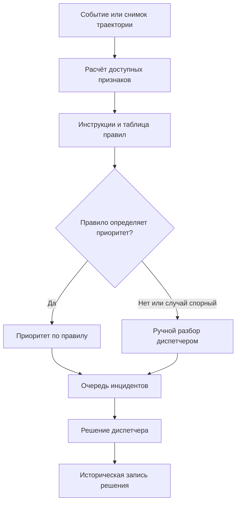
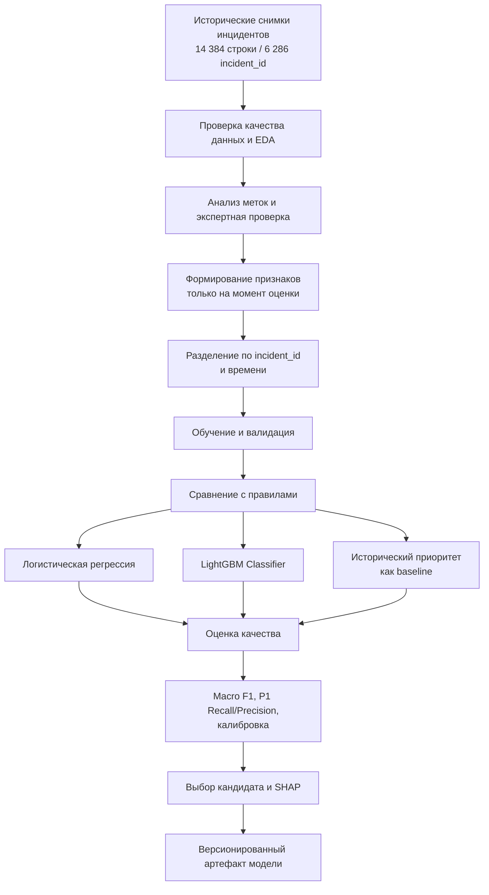
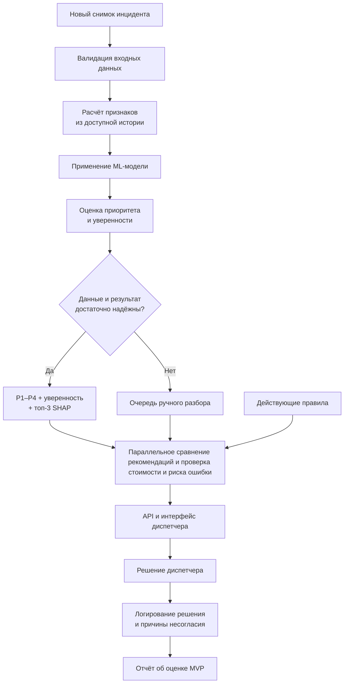

# ML System Design Doc -- [RU]

## Дизайн ML системы -- Industrial Event Ranker (Умный помощник диспетчера), MVP, итерация 1

**Версия:** 0.2

# 1. Цели и предпосылки

## 1.1. Зачем идём в разработку продукта?

### Бизнес-цель -- Product Owner

Разработать интеллектуальный помощник диспетчера крупного логистического терминала, который автоматически приоритизирует активные инциденты на основе пространственных, временных и поведенческих характеристик объектов.

На площадке одновременно перемещаются ричтраки, погрузчики, тягачи и пеший персонал. Диспетчер получает порядка 200–400 событий за смену, из которых ориентировочно 10–20 требуют немедленной реакции.

Текущий процесс предполагает ручной разбор событий на основе инструкций, таблиц правил и экспертного опыта диспетчера. Это приводит к увеличению времени обработки очереди, неоднородности решений разных специалистов и риску того, что критический инцидент будет обработан позже менее значимого события.

**Цель продукта** -- повысить качество приоритизации и помочь диспетчеру своевременно выявлять наиболее критические инциденты, в том числе в ситуациях, которые не покрываются заранее заданными правилами.

### Почему ML может быть лучше текущего решения -- Product Owner & Data Scientist

Существующая система использует детерминированные правила вида «объект находится в зоне X, а расстояние до оборудования меньше Y -- присвоить высокий приоритет».

Такой подход эффективен для известных сценариев, однако имеет ограничения:

- не учитывает все комбинации признаков и нестандартные траектории движения;
- может недостаточно точно различать события одинакового формального типа, но с разным уровнем опасности;
- зависит от полноты правил и их своевременного обновления;
- не гарантирует согласованности решений разных диспетчеров.

ML-модель должна научиться оценивать приоритет по совокупности характеристик инцидента: расположению объекта, типу зоны, близости людей и оборудования, скорости и направлению движения, отклонениям от типичного поведения и истории наблюдений.

Модель не заменяет инструкции и не принимает решения о реагировании самостоятельно. Она формирует рекомендации, объясняет их и помогает диспетчеру эффективнее распределять внимание.

### Что считаем успехом итерации с точки зрения бизнеса -- Product Owner

Успешная итерация должна подтвердить техническую и продуктовую целесообразность применения ML для приоритизации инцидентов.

Критерии успеха:

1. На отложенных данных качество классификации приоритета не хуже согласованного бейзлайна: контролируются macro F1, F1/Recall/Precision для P1 и P2, а также матрица ошибок.
2. Модель корректно выделяет критические события P1. Очередь сортируется по предсказанному классу (P1 выше P2, P2 выше P3, P3 выше P4), а внутри класса -- по уверенности модели.
3. Для групп очередей, полнота которых подтверждена, дополнительно измеряются NDCG\@10 и Recall\@10(P1). До накопления достаточного числа полных очередей эти метрики являются диагностическими.
4. Для каждого рекомендованного приоритета предоставляются оценка уверенности и объяснение на основе признаков.
5. При недостаточных данных или низкой надёжности модель передаёт событие на ручной разбор вместо выдачи необоснованной рекомендации.
6. Время от поступления новых данных до обновления приоритета и очереди не превышает 5 секунд в рамках тестового стенда.
7. Прототип позволяет сравнивать рекомендации модели с текущими правилами и сохранять решения диспетчера, включая причины несогласия.

Целевые абсолютные значения качества и минимальный необходимый прирост относительно бейзлайна будут зафиксированы после первичного измерения бейзлайна и анализа данных, но до итоговой оценки на тестовой выборке.

Разработка не предполагает автоматического управления техникой или автоматического выполнения действий по устранению инцидентов.

## 1.2. Бизнес-требования и ограничения

### Краткое описание бизнес-требований -- Product Owner

**Industrial Event Ranker** -- интеллектуальная система ранжирования активных инцидентов на логистическом терминале.

В систему поступает информация о движущихся объектах и связанных с ними событиях. Для каждого инцидента формируется снимок состояния на момент оценки. На основании доступных признаков модель рассчитывает приоритет, после чего активные инциденты упорядочиваются для диспетчера.

Система должна поддерживать следующие сценарии:

- появление движущегося объекта в запретной или опасной зоне;
- приближение техники к человеку или ценному оборудованию;
- необычная траектория, резкое изменение направления или остановка в неположенном месте;
- нарушение границы разрешённой зоны;
- движение транспорта в пешеходной зоне;
- отклонение поведения объекта от типичного для соответствующей зоны.

Для каждого инцидента система должна предоставлять:

- приоритет P1 -- критический, P2 -- высокий, P3 -- средний, P4 -- низкий;
- отдельную оценку уверенности модели;
- топ-3 признаков, наиболее повлиявших на результат;
- краткое текстовое объяснение рекомендации;
- статус ручной проверки, если качество входных данных или уверенность модели недостаточны.

Внешний документ бизнес-требований не предоставлен. Данный раздел фиксирует требования, согласованные в рамках проектирования MVP.

### Бизнес-ограничения -- Product Owner

| Ограничение                 | Требование                                                                             |
| --------------------------- | -------------------------------------------------------------------------------------- |
| Источник данных             | Имеющиеся исторические данные                                                          |
| Объём                       | Текущая выгрузка: 14 384 снимка, 35 исходных полей, 6 286 уникальных incident_id и 14 105 уникальных snapshot_id |
| Разметка                    | `expert_priority`: 9 563 снимка (66,5%); `historical_priority`: 13 186 снимков (91,7%) |
| Идентификация               | `incident_id`, `snapshot_id`, `queue_id`, `queue_refresh_time`, `dispatcher_session_id` |
| Обновление приоритета       | Не более 5 секунд от поступления новых данных до обновления очереди на тестовом стенде |
| Интерпретируемость          | Топ-3 признака и текстовое пояснение обязательны                                       |
| Принятие решений            | Окончательное решение принимает диспетчер                                              |
| Безопасное поведение        | Неуверенные и некорректные случаи направляются на ручную проверку                      |
| Производственная интеграция | Не входит в MVP                                                                        |
| Автоматическое реагирование | Не входит в MVP                                                                        |

### Что ожидаем от конкретной итерации -- Product Owner

В рамках первой итерации необходимо:

1. Провести EDA и оценить пригодность исторических данных для обучения.
2. Проверить полноту признаков, качество меток, распределение приоритетов и особенности повторных снимков одного инцидента.
3. Сформировать воспроизводимый процесс подготовки обучающей выборки.
4. Реализовать бейзлайн на основе действующих правил.
5. Сравнить несколько ML-подходов для оценки приоритета.
6. Определить применимость отдельного learning-to-rank решения.
7. Подготовить API и простой интерфейс диспетчера.
8. Реализовать объяснения прогнозов, оценку уверенности и сценарии fallback.
9. Подготовить отчёт о качестве моделей, сравнении с бейзлайном и ограничениях решения.

### Описание бизнес-процесса пилота

Полноценный производственный пилот не входит в объём работы. Вместо него будет реализован тестовый стенд с возможностью воспроизводить исторические события и просматривать рекомендации модели параллельно результатам действующих правил.

Предполагаемый процесс:

1. В тестовый контур загружается снимок состояния инцидента.
2. Система рассчитывает признаки, доступные на момент оценки.
3. Действующие правила и ML-модель формируют собственные рекомендации.
4. Интерфейс показывает диспетчеру ранжированный список, приоритеты, уверенность и объяснения.
5. Диспетчер может принять рекомендацию или изменить приоритет.
6. Решение диспетчера, итоговый приоритет и причина несогласия сохраняются для последующего анализа.

Стенд используется для сравнительной оценки на исторических данных и контролируемой демонстрации работы системы. Подключение к производственной инфраструктуре и изменение реального процесса управления терминалом не выполняются.

### Что считаем успешным пилотом и возможные пути развития -- Product Owner

Для MVP успех подтверждается следующими результатами:

- на отложенных данных проведено сравнение модели с существующими правилами;
- рассчитаны macro F1, Precision/Recall/F1 для P1 и P2, матрица ошибок и качество калибровки;
- на подтверждённых полных группах очередей дополнительно рассчитаны Recall\@10(P1) и NDCG\@10; при недостаточном покрытии эти метрики трактуются как диагностические;
- проверено отсутствие существенного ухудшения выявления критических инцидентов относительно бейзлайна;
- обеспечено обновление очереди в пределах установленного временного ограничения;
- реализована выдача приоритета, оценки уверенности и объяснения либо перевод события на ручную проверку;
- подготовлен работающий сервис с API и интерфейсом;
- результаты экспериментов воспроизводимы и документированы.

Конкретный минимальный прирост метрик утверждается по итогам оценки бейзлайна до начала работы с тестовой выборкой.

Возможные следующие этапы развития:

- увеличение объёма и качества экспертной разметки;
- улучшение качества моделей для редких критических классов;
- сбор обратной связи диспетчеров;
- мониторинг изменения распределения признаков и качества рекомендаций;
- организация регулярного переобучения после накопления достаточного объёма новых подтверждённых данных.

## 1.3. Что входит в скоуп проекта/итерации, что не входит

### На закрытие каких бизнес-требований подписываемся -- Data Scientist

В рамках MVP будут выполнены следующие работы.

**Работа с данными:**

- аудит текущей выгрузки объёмом 14 384 снимка, 35 исходных полей и 6 286 уникальных инцидентов;
- анализ полноты, типов и распределения признаков;
- исследование распределения инцидентов по зонам, типам событий и уровням приоритета;
- выявление дисбаланса классов, пропусков, дубликатов и потенциальных ошибок разметки;
- проверка возможности восстановления групп одновременно активных инцидентов.

**Подготовка разметки:**

- анализ исторических приоритетов и их согласованности с экспертными метками;
- использование `expert_priority` в качестве основной целевой переменной;
- планирование стратифицированной экспертной разметки части снимков без метки и проверки спорных случаев;
- проверка критических меток по фактическим последствиям только там, где соответствующие поля заполнены;
- сохранение источника каждой метки; историческая метка не подменяет экспертную.

**Разработка моделей:**

- реализация или подключение бейзлайна на основе действующих правил; `historical_priority` использовать как отдельный параметр оценки качества;
- обучение логистической регрессии как простого ML-бейзлайна;
- обучение LightGBM для классификации приоритета;
- оценка применимости learning-to-rank как направления следующей итерации; отдельный Ranker не входит в обязательный MVP до подтверждения полноты очередей и накопления достаточного числа query-групп;
- сравнение классификационных моделей на единых временных выборках и по единым критериям.

**Создание прототипа:**

- API на FastAPI;
- простой интерфейс диспетчера;
- расчёт признаков и применение модели;
- вывод приоритета и оценки уверенности;
- SHAP-объяснения для поддерживаемых моделей;
- проверка входных данных и fallback;
- логирование рекомендаций, решений диспетчера и причин несогласия;
- контейнеризация с помощью Docker.

### Что не будет закрыто -- Data Scientist

В рамках текущей итерации не предусматриваются:

- сбор новых данных с датчиков и изменение существующей системы сбора;
- интеграция с реальной производственной инфраструктурой;
- полноценный эксплуатационный пилот;
- автоматическое выполнение действий по реагированию на инциденты;
- автоматическая генерация рекомендаций по устранению инцидентов;
- полноценная промышленная инфраструктура мониторинга и переобучения;
- гарантированная работа при промышленной нагрузке, отказоустойчивость и масштабирование;
- доказательство снижения фактического ущерба или времени реакции на реальной площадке.

Эти ограничения необходимо учитывать при интерпретации результатов: высокая офлайн-метрика подтвердит перспективность подхода, но сама по себе не доказывает снижение производственных рисков.

### Качество кода и воспроизводимость -- Data Scientist

Результат должен представлять собой воспроизводимый программный прототип со следующими характеристиками:

- раздельные модули подготовки данных, генерации признаков, обучения, оценки и инференса;
- единая схема входных данных и результатов модели;
- фиксированные версии библиотек и зависимостей;
- конфигурация экспериментов и фиксируемые случайные состояния там, где они применимы;
- сохранение параметров обучения, версий моделей и результатов экспериментов;
- воспроизводимая процедура формирования обучающей и тестовой выборок;
- автоматизированные проверки схемы данных и обязательных признаков;
- Docker-конфигурация для запуска приложения;
- документированная инструкция запуска и воспроизведения экспериментов.

### Планируемый технический долг -- Data Scientist

Для ускорения разработки MVP допускаются следующие ограничения:

- хранение конфигураций и артефактов локально либо в простом файловом хранилище;
- упрощённый мониторинг качества и производительности;
- ручное управление версиями моделей;
- отсутствие автоматического переобучения;
- ограниченная поддержка новых категорий и неизвестных типов событий;
- упрощённая логика обнаружения объектов, не похожих на обучающие примеры;
- отсутствие промышленной отказоустойчивости и масштабирования;
- ограниченная автоматизация сбора и экспертной проверки новых меток.

## 1.4. Предпосылки решения

### Объект и гранулярность модели -- Data Scientist

Основная единица анализа -- **снимок состояния инцидента на конкретный момент времени**.

Один инцидент может представляться несколькими снимками по мере поступления новых наблюдений. Система пересчитывает его приоритет при изменении значимых признаков.

Каждый снимок должен содержать `incident_id`, временную метку оценки и набор признаков, доступных на соответствующий момент.

Модель не прогнозирует окончательные последствия инцидента и не использует финальные сведения о нём как входные признаки. Её задача -- определить приоритет на основании текущего состояния и доступной истории.

### Источники данных

По результатам EDA текущая выгрузка `incidents_raw_1.csv` содержит 14 384 снимка и 35 исходных полей, 6 286 уникальных `incident_id` и 14 105 уникальных `snapshot_id`. Корректная экспертная метка P1–P4 заполнена у 9 563 снимков (66,5%), историческая метка -- у 13 186 снимков (91,7%). На уровне уникальных инцидентов экспертная метка присутствует у 4 239 из 6 286 инцидентов; конфликтующих экспертных меток внутри одного `incident_id` не обнаружено.

В схеме присутствует `has_clock_skew`: 71 строка (0,49%) помечена как имеющая проблему синхронизации времени. После исключения этих строк остаётся 14 313 валидных снимков и 4 234 уникальных размеченных инцидента. На очищенной части не обнаружено снимков позже `incident_end_time`, нарушений порядка start/end, отрицательного лага относительно `queue_refresh_time` или расхождений `incident_duration_sec` с возрастом инцидента на момент снимка.

Поля `queue_id`, `queue_refresh_time` и `dispatcher_session_id` позволяют восстановить диагностические группы одновременных событий. Полнота состава очереди по этим ключам пока не подтверждена, поэтому ranking-метрики интерпретируются с ограничениями. Все технические идентификаторы используются только для группировки и аудита, но не как предикторы.

### Основные группы признаков

| Группа             | Примеры признаков                                                       | Правила использования                                         |
| ------------------ | ----------------------------------------------------------------------- | ------------------------------------------------------------- |
| Местоположение     | Координаты, идентификатор площадки, расстояние до границ зон и объектов | Значения, доступные на момент оценки                          |
| Зоны               | Тип зоны, уровень опасности, режим доступа                              | Актуальные характеристики зоны                                |
| Ближайшие объекты  | Тип, расстояние, значимость и состояние объекта                         | Только сведения, известные на момент оценки                   |
| Движение           | Скорость, направление, ускорение, изменение траектории                  | Расчёт по текущим и прошлым наблюдениям                       |
| Временной контекст | Время суток, день недели, длительность инцидента, число наблюдений      | Длительность рассчитывается только на момент оценки           |
| Контекст события   | Тип события, источник, число предыдущих инцидентов с объектом           | Только историческая информация                                |
| Целевая метка      | P1–P4, экспертная оценка, доступные последствия                         | Используется для обучения и оценки, но не как входной признак |

### Целевая переменная и доверие к меткам

Основная целевая переменная -- экспертно подтверждённый приоритет инцидента.

Для формирования и проверки обучающей выборки используются следующие источники:

1. **Экспертные приоритеты (`expert_priority`).** Основная целевая переменная. В текущей выгрузке она заполнена в 9 563 снимках (66,5%); на уровне инцидентов метка есть у 4 239 из 6 286 инцидентов до исключения записей с проблемами времени. Противоречащих экспертных меток внутри одного `incident_id` не обнаружено.
2. **Исторические приоритеты (`historical_priority`).** Заполнены в 13 186 снимках (91,7%). Для 8 755 снимков, где доступны обе метки, точное совпадение с экспертной разметкой составляет 83,4%, совпадение в пределах одного уровня -- 98,1%, quadratic weighted Cohen's kappa -- 0,884. Исторический приоритет полезен как proxy-baseline и может проверяться как дополнительный обучающий источник с отдельным пониженным весом, но не заменяет экспертную целевую переменную.
3. **Фактические последствия (`historical_outcome`, `consequence_severity`).** Используются только для ретроспективного аудита и проверки отдельных критических случаев. Поля сильно разрежены и относятся к сведениям, которые могут быть известны только после инцидента; в матрицу входных признаков не включаются.

В текущей выгрузке нет отдельной разметки экспертных попарных сравнений «какой инцидент важнее». При необходимости такой сигнал следует собирать отдельно. Для текущего MVP порядок очереди формируется классификатором, а восстановленные группы используются только для диагностической проверки ранжирования.

Источник каждой метки должен сохраняться. Экспертная и историческая разметка анализируются раздельно; результаты обучения с дополнительными историческими метками оцениваются исключительно на отложенной выборке с экспертной разметкой.

### Предположения о временной структуре

1. Для одного `incident_id` могут существовать несколько снимков состояния.
2. Все признаки рассчитываются только по наблюдениям, время которых не позже момента оценки.
3. Признаки, требующие знания будущего события, не используются.
4. Все снимки одного инцидента должны попадать только в одну выборку при разделении данных на train, validation и test.
5. Предпочтительно использовать временное разделение по моменту начала инцидента, чтобы оценка лучше отражала будущую эксплуатацию.

Если данные не позволяют восстановить временную последовательность и набор одновременно активных инцидентов, возможности оценки ранжирования должны быть отдельно ограничены и задокументированы.

### Требования к приоритету, уверенности и объяснению

Выход модели включает три независимых компонента:

- **Приоритет:** P1 -- критический, P2 -- высокий, P3 -- средний, P4 -- низкий.
- **Уверенность:** вероятность предсказанного класса для классификационной модели.
- **Объяснение:** три наиболее значимых признака с краткой текстовой интерпретацией.

Численная оценка ранжировщика не должна автоматически интерпретироваться как вероятность. Если отдельный ranking-подход окажется лучшим по метрикам, способ оценки его надёжности необходимо проверить отдельно.

### Предположения по безопасности

Если отсутствуют обязательные признаки, встречаются неизвестные или некорректные значения либо надёжность оценки ниже установленного порога, инцидент направляется в отдельную очередь «Требует ручного разбора».

Порог уверенности и правила обработки неизвестных данных определяются на валидационной выборке. При этом безопасность не должна зависеть исключительно от уверенности модели: обязательные проверки качества входных данных выполняются независимо.

# 2. Методология

## 2.1. Постановка задачи -- Data Scientist

### Основная ML-задача

Основная задача MVP -- **supervised многоклассовая классификация экспертного приоритета P1–P4** по снимку состояния инцидента. Целевая переменная -- `expert_priority`. В текущей выгрузке метка постоянна внутри `incident_id`, поэтому все снимки одного инцидента обязательно объединяются в одну группу при разделении данных.

В эксплуатации модель выдаёт класс P1–P4 и вероятности классов. Очередь формируется в два шага: сначала инциденты сортируются по предсказанному приоритету (P1 выше P2, P2 выше P3, P3 выше P4), затем внутри одного класса упорядочиваются по уверенности модели. Таким образом, MVP использует классификатор для формирования порядка, а не отдельную learning-to-rank модель.

Такой выбор соответствует фактической структуре выгрузки: экспертная метка доступна для 9 563 снимков (66,5%) и 4 239 уникальных инцидентов до временной фильтрации; после исключения временно некорректных записей остаётся 4 234 размеченных инцидента. Пригодных для проверки top-10 групп очереди существенно меньше (очередей с подвержденными оценками для >11 элементов 43 шт.).

### Распределение целевых меток и доверие к ним

Среди 9 563 снимков с экспертной меткой распределение следующее:

| Приоритет | Снимков | Доля размеченных снимков | Уникальных размеченных инцидентов |
| --- | ---: | ---: | ---: |
| P1 | 1 097 | 11,5% | 475 |
| P2 | 1 906 | 19,9% | 840 |
| P3 | 2 459 | 25,7% | 1 094 |
| P4 | 4 101 | 42,9% | 1 830 |

P4 встречается примерно в 3,7 раза чаще P1. Это заметный, но не экстремальный дисбаланс: class weighting следует сравнить с обычной cross-entropy, а не включать автоматически. Долю независимых инцидентов следует считать важнее количества повторных снимков.

`historical_priority` заполнен в 13 186 строках (91,7%); среди корректных исторических меток P1 составляет 10,5%, P2 -- 18,5%, P3 -- 32,8%, P4 -- 38,2%. На 8 755 строках с обеими метками exact agreement равен 83,4%, agreement within one level -- 98,1%, quadratic weighted Cohen's kappa -- 0,884. Историческая метка подходит для сравнения с прежним процессом и отдельного эксперимента с дополнительными обучающими данными, но не должна попадать в `X` и не должна без проверки подменять `expert_priority`.

### Сравниваемые подходы

**1. Бейзлайн -- действующие детерминированные правила**

Действующие правила восстанавливаются отдельной функцией `baseline_rules(snapshot)` и применяются к тем же снимкам, что и ML-модель. Правила покрывают шесть сценариев из бизнес-описания (пешеход рядом с техникой, вторжение в запретную зону, нарушение режима доступа, высокая скорость в опасной зоне, необычная траектория, транспорт в пешеходной зоне) и используют те же признаки: `event_type`, `zone_type`, `zone_hazard_level`, `access_mode`, `distance_to_zone_border`, `nearest_object_distance`, `speed_mps`, `trajectory_change`. Пороги подбираются на train (grid search по F1(P1)), а не задаются вручную. Правила **независимы** от `historical_priority` и **не используют** экспертную метку как вход -- иначе сравнение с ML было бы нечестным. Именно этот baseline является основным ориентиром для оценки прироста ML в MVP.

**2. Бейзлайн -- исторический приоритет оператора (`historical_priority`)**

`historical_priority` -- прокси **реального решения диспетчера в проде**, не экспертная разметка и не ответ правил. Метка полная (~91.7%), но смещена к P3 и зашумлена (~15%), поэтому используется как auxiliary target с весом `w_historical ≈ 0.3–0.5`.

**Цель сравнения** -- проверить, приближается ли ML-модель к **реальным действиям диспетчера в сложной обстановке**, а не к мнению отдельного эксперта и не к формальным правилам. Диспетчер работает в условиях перегрузки, неполных данных и пересекающихся инцидентов -- там, где правила систематически ошибаются. Согласие модели с `historical_priority` на отложенных данных (accuracy, macro-F1, совпадение по P1/P2) показывает, насколько она воспроизводит рабочую логику человека в очереди.

Это **третий, независимый срез качества**, не заменяющий оценку на `expert_priority` и не конкурирующий с baseline из правил. Ранжирование на исторической очереди -- справочное: сортировка по `historical_priority` согласована сама с собой и не является независимой оценкой.

**3. Простой ML-бейзлайн -- логистическая регрессия**

Многоклассовая логистическая регрессия проверяет, достаточно ли линейных зависимостей между признаками и приоритетами. Она задаёт интерпретируемую контрольную линию и позволяет отделить вклад нелинейностей LightGBM.

**4. Основной кандидат -- LightGBM Classifier**

LightGBM для классификации рассматривается как основной кандидат для табличных признаков: он позволяет учитывать нелинейные зависимости и взаимодействия между контекстом зоны, типом события, скоростью и дистанциями. CatBoost может быть дополнительным экспериментом, если справочники категорий будут стабилизированы.

**Learning-to-rank -- не будет входить в MVP.**

В текущем EDA после фильтра временных аномалий и схлопывания повторных снимков одного инцидента в одной группе получено 9 457 групп очереди. При этом только 601 группа содержит два или более экспертно размеченных инцидента, а 43 группы -- 11 или более размеченных участников (38 из них содержат P1). В 152 группах с двумя и более экспертными метками одновременно присутствуют и неразмеченные участники. Этого недостаточно для устойчивого обучения и приёмочной оценки отдельного Ranker. Возврат к LightGBM Ranker/LambdaMART возможен после подтверждения полноты очередей и накопления значительно большего числа независимых query-групп.

### Подготовка данных и разделение выборок

План подготовки данных:

1. Проверить схему, типы, пропуски, дубликаты, повторяющиеся ключи и диапазоны значений.
2. Нормализовать приоритеты и категории с сохранением исходных значений для аудита.
3. Исключить строки с `has_clock_skew=True`; повторно проверить хронологию, возраст инцидента и соответствие `snapshot_time` времени обновления очереди.
4. Разрешить конфликтующие ключи `(incident_id, snapshot_time)` до обучения; точные повторы удалить после сохранения аудита.
5. Формировать признаки только из информации, доступной на момент `snapshot_time`.
6. Разделить данные хронологически на уровне уникального `incident_id`.
7. Настраивать предобработку, веса классов, гиперпараметры и пороги только на train/validation.
8. Один раз оценить выбранную модель на отложенном test.

После исключения 71 строки с `has_clock_skew=True` остаётся 14 313 валидных снимков и 4 234 уникальных размеченных инцидента. Хронологическое разбиение по `incident_start_time` в пропорции 70/15/15 даёт:

| Выборка | Уникальных размеченных инцидентов | P1 | P2 | P3 | P4 |
| --- | ---: | ---: | ---: | ---: | ---: |
| Train | 2 963 | 334 | 586 | 767 | 1 276 |
| Validation | 635 | 73 | 126 | 151 | 285 |
| Test | 636 | 68 | 127 | 175 | 266 |

Пересечений `incident_id` между частями нет. В test находится 68 независимых P1 -- это позволяет провести первичную учебную оценку, но доверительный интервал метрик P1 остаётся заметным.

Групповой split необходим из-за повторных снимков: на один `incident_id` приходится в среднем 2,29 снимка (медиана 2, 95-й процентиль 5, максимум 7). Экспертная метка внутри инцидента не конфликтует, поэтому при обучении нужно контролировать, чтобы инциденты с большим числом снимков не получали непропорционально большой вес. Возможные варианты -- фиксировать правило выбора актуального снимка или использовать веса снимков, обратные числу снимков одного инцидента.

Неразмеченные по `expert_priority` снимки не получают псевдометку автоматически. Отдельный эксперимент может добавить строки только с `historical_priority` с пониженным весом; его результат оценивается исключительно на test с экспертными метками.

### Функции потерь и метрики качества

**Функции потерь для классификации:**

- Базовая -- multiclass cross-entropy / log loss. Она служит контрольной точкой и позволяет оценивать вероятности классов.
- Сравниваемый вариант -- weighted cross-entropy с весами, рассчитанными только на train. Поскольку P4 встречается примерно в 3,7 раза чаще P1, веса могут улучшить Recall P1, однако их величина выбирается по validation с контролем роста ложных тревог.
- Дополнительный вариант -- cost-sensitive loss с матрицей стоимости ошибок: пропуск P1 и прогноз P3/P4 для фактического P1 штрафуются сильнее, чем соседняя ошибка P2↔P3. Матрица утверждается с владельцем процесса.
- Focal loss допускается только как отдельный эксперимент, если стандартная и взвешенная cross-entropy не дают приемлемого результата.

**Основные метрики классификации:**

- `macro F1` -- баланс качества по всем четырём классам;
- `Recall(P1)` -- основная safety-метрика пропуска критических событий;
- `Precision(P1)` и `F1(P1)` -- контроль ложных тревог;
- `F1(P2)` и per-class precision/recall/F1 -- контроль качества остальных приоритетов;
- confusion matrix -- разбор типов ошибок и направления смешения классов;
- multiclass log loss / Brier score и калибровка -- оценка вероятностей;
- доля событий, отправленных на ручной разбор, -- контроль эксплуатационной применимости.

`NDCG@10`, `Recall@10(P1)` и `Precision@10` рассчитываются только на восстановленных группах очереди с достаточным количеством экспертно размеченных участников. В текущей выгрузке таких плотных групп мало, поэтому метрики используются как диагностические.

### Блок формирования очереди

Классификационная модель возвращает предсказанный класс и вероятности P1–P4. В интерфейсе сначала применяется порядок классов P1 → P2 → P3 → P4, затем сортировка по вероятности предсказанного класса внутри класса. Порог уверенности и перевод в ручной разбор настраиваются на validation. Вероятность не должна интерпретироваться как гарантированная вероятность фактического ущерба.

### Результат этапа

Результат этапа -- воспроизводимый классификационный pipeline, сравнение Logistic Regression и LightGBM на едином временном split, зафиксированный baseline, откалиброванные вероятности и правила fallback. Отдельный Ranker не является условием завершения MVP; его разработка переносится до появления полноценных и достаточно многочисленных query-групп.

## 2.2. Блок-схема решения -- Data Scientist

### Бейзлайн: действующий процесс

Бейзлайн должен отражать текущую логику приоритизации и использоваться как контрольная система при оценке MVP.

Существующий процесс обеспечивает обработку типовых событий, но зависит от полноты правил и индивидуального опыта специалистов. Этот процесс является основным бейзлайном для сравнения.

### MVP: подготовка данных и обучение

Данный пайплайн включает анализ качества исторической разметки. Экспертно подтверждённые метки используются как основной источник целевой переменной. `historical_priority` применяется для сравнения с историческим процессом и может проверяться как дополнительный источник обучения с пониженным весом; фактические последствия используются только для ретроспективного аудита. Learning-to-rank остаётся будущим экспериментом, поскольку в текущей выгрузке недостаточно плотных и полностью размеченных очередей.

### MVP: применение модели и формирование очереди

Архитектура обеспечивает параллельный показ результатов правил и ML-модели. Диспетчер сохраняет право окончательного решения.

Обновление приоритета должно укладываться в пять секунд на тестовом стенде. При измерении необходимо отдельно фиксировать задержку обработки и задержку полного обновления интерфейса.

Fallback переводит событие в отдельную очередь «Требует ручного разбора». Такая очередь должна быть заметной для диспетчера, а не смешиваться с подтверждёнными событиями P1.

## 2.3 План технической реализации

**Основной стек:**

- Python;
- pandas и scikit-learn;
- LightGBM;
- SHAP;
- FastAPI;
- Docker;
- простой веб-интерфейс.

Планируемые компоненты:

1. Модуль загрузки и валидации данных.
2. Модуль расчёта признаков.
3. Пайплайн обучения и оценки.
4. Модуль применения модели и калибровки уверенности.
5. Модуль объяснений.
6. API для получения рекомендаций и обновления очереди.
7. Интерфейс просмотра активных инцидентов.
8. Логирование решений и результатов проверки.

## 2.4. Этапы решения задачи -- Data Scientist

Этапы ниже зафиксированы по результатам EDA выгрузки `incidents_raw_1.csv`: 14 384 снимка, 35 исходных полей и 6 286 уникальных `incident_id`. Для MVP разделяются подготовка классификационной выборки на уровне инцидента и диагностическое восстановление очередей. Основной практический путь -- классификация экспертного приоритета с последующей сортировкой по классу и уверенности; отдельная LTR-модель пока не обоснована объёмом query-групп.

### Этап 1. Подготовка данных

#### 1.1. Данные, сущности и объём

Основная таблица содержит снимки состояния инцидентов. Одна строка соответствует `snapshot_id` и состоянию инцидента в `snapshot_time`. Основная единица группировки -- `incident_id`: один инцидент может иметь несколько снимков и одну экспертную метку.

| Данные / сущность | Поля | Роль в решении | Фактический результат EDA |
| --- | --- | --- | --- |
| Снимки инцидентов | `snapshot_id`, `incident_id`, `snapshot_time` | Основной уровень входных данных | 14 384 строки; 35 исходных полей; 14 105 уникальных `snapshot_id`; 6 286 уникальных инцидентов |
| Повторные снимки | `incident_id`, `snapshot_time` | Временная последовательность состояния одного инцидента | В среднем 2,29 снимка на инцидент; медиана 2, 95-й процентиль 5, максимум 7; конфликтующих экспертных меток внутри инцидента не обнаружено |
| Контекст очереди | `queue_id`, `queue_refresh_time`, `dispatcher_session_id` | Восстановление диагностических query-групп | 9 478 уникальных `queue_id` и столько же `queue_refresh_time`; один `queue_id` связан с одним refresh time, но 16 значений `queue_id` встречаются в нескольких сессиях |
| Временные поля | `incident_start_time`, `incident_end_time`, `incident_duration_sec`, `has_clock_skew` | Проверка актуальности снимка и расчёт возраста инцидента | 71 строка (0,49%) имеет `has_clock_skew=True`; после исключения остаётся 14 313 строк |
| Контекст события и объекта | `event_type`, `object_type`, `zone_id`, `zone_type`, `zone_hazard_level`, `access_mode`, `nearest_object_type` | Категориальные признаки и контекст риска | После нормализации регистра/пробелов: `event_type` 12 → 6 вариантов, `object_type` 15 → 6, `zone_type` 21 → 9; выявлены дополнительные семантические алиасы |
| Пространственные и динамические признаки | `x`, `y`, `speed_mps`, `heading_deg`, `acceleration`, `trajectory_change`, расстояния | Основные кандидаты в `X` | Наиболее выраженные монотонные связи с экспертным приоритетом у расстояния до границы, скорости, дистанции до ближайшего объекта, изменения траектории и ускорения |
| Экспертная целевая метка | `expert_priority` | Основная `y` для P1–P4 | 9 563 размеченных снимка (66,5%); P1 1 097, P2 1 906, P3 2 459, P4 4 101; 4 239 уникальных размеченных инцидентов до временной фильтрации и 4 234 после неё |
| Историческая метка | `historical_priority` | Исторический baseline прокси-оценка и возможный дополнительный обучающий источник | 13 186 корректных меток (91,7%); обе корректные метки одновременно присутствуют в 8 755 строках; точное согласие с экспертной меткой 83,4%, weighted kappa 0,884 |
| Ретроспективные последствия | `historical_outcome`, `consequence_severity` | Только анализ постфактум | Пропуски 88,14% и 99,07% соответственно; не включать в `X` |

Среди 9 563 снимков с экспертной разметкой распределение классов: P1 -- 11,5%, P2 -- 19,9%, P3 -- 25,7%, P4 -- 42,9%. P4 встречается примерно в 3,7 раза чаще P1. На уровне уникальных размеченных инцидентов до временного фильтра распределение -- P1 475, P2 840, P3 1 094, P4 1 830.

#### 1.2. Выявленные проблемы качества и правила подготовки

1. **Пропуски.** `secondary_object_distance` отсутствует в 99,78% строк (доступно 32 значения), `consequence_severity` -- в 99,07% (134 значения), `historical_outcome` -- в 88,14% (1 706 значений). Эти поля не входят в MVP-признаки. Умеренная неполнота наблюдается у `acceleration` (25,50%), `trajectory_change` (20,29%), `previous_incidents_count` (14,75%) и `nearest_object_distance` (9,96%). Для них следует сравнить включение в pipeline c индикаторами пропусков. Доля пропусков по этим признакам близка между классами, поэтому удаление строк целиком нецелесообразно.
2. **Дубликаты и коллизии ключей.** Найдено 279 дополнительных точных повторов строк (1,94%); 14 105 уникальных `snapshot_id` при 14 384 строках. Ключ `(incident_id, snapshot_time)` повторяется в 416 группах (834 строки): 277 групп не имеют различий в содержательных полях, а в 139 группах различаются `x`, `y`, `speed_mps`, `distance_to_zone_border` и `snapshot_id`. Точные копии можно удалить после сохранения аудита. 139 конфликтующих групп нельзя схлопывать произвольно: до обучения требуется правило приоритета источника/версии или ручная проверка.
3. **Сбой синхронизации времени.** 71 строка (0,49%) отмечена `has_clock_skew=True`; эти строки формируют временной хвост после основного периода выгрузки. Они исключаются из основной классификационной и ranking-выборок. На оставшихся 14 313 строках нарушений `snapshot_time < incident_start_time`, `incident_end_time < incident_start_time`, `snapshot_time > incident_end_time`, отрицательного лага относительно `queue_refresh_time` или лага более пяти минут не обнаружено. `incident_duration_sec` совпадает с `snapshot_time - incident_start_time` с точностью до 0,1 секунды во всех оставшихся строках.
4. **Задержка обновления очереди.** На очищенных строках разница `snapshot_time - queue_refresh_time` составляет в среднем около 150 секунд, медиана -- 150 секунд, максимум -- менее 300 секунд. Это согласуется с пятиминутным окном в текущей выгрузке; в production-контракте необходимо зафиксировать допустимую задержку и поведение для опоздавших сообщений.
5. **Аномальные диапазоны.** `speed_mps > 50` встречается в 62 строках (0,43%), максимум -- 195,8 м/с; отрицательной скорости нет. Отрицательный `nearest_object_distance` обнаружен в 55 строках (0,38%). `distance_to_zone_border` отрицателен в 2 550 строках (17,73%) и, вероятно, является знаковым расстоянием относительно границы; знак нельзя убирать до документирования семантики. У 37 строк (0,26%) модуль `acceleration` превышает 10 м/с²; диапазон в данных -- примерно от −25,0 до 24,3 м/с². Автоматическое clipping/winsorization не применяется без проверки единиц измерения и сценариев.
6. **Категориальные значения.** Нормализация регистра, пробелов и разделителей сокращает количество вариантов `zone_type` с 21 до 9, `event_type` с 12 до 6, `object_type` с 15 до 6. Кандидаты на семантическое объединение: `rt → reach_truck`, `ped → pedestrian`, `ped_path → pedestrian_path`, `restricted_zone → restricted`, `maintenance_area → maintenance`. До утверждения словаря исходные и нормализованные значения хранятся параллельно; проверяется влияние объединения на метрики.
7. **Согласованность разметки.** Для 8 755 строк с двумя корректными метками exact agreement `expert_priority` и `historical_priority` составляет 83,4%, agreement within one level -- 98,1%, quadratic weighted Cohen's kappa -- 0,884. Историческая метка хорошо согласуется по порядку, но не взаимозаменяема с экспертной; расхождения сохраняются для анализа.
8. **Сигнал признаков.** Наибольшие по модулю Spearman-корреляции с порядковым экспертным приоритетом: `distance_to_zone_border` (ρ≈−0,579), `speed_mps` (ρ≈0,576), `nearest_object_distance` (ρ≈−0,572), `trajectory_change` (ρ≈0,571), `acceleration` (ρ≈0,471). У `time_of_day` (ρ≈0,028), `previous_incidents_count` (ρ≈0,017), `n_observations` (ρ≈0,008), `day_of_week` (ρ≈0,005) и `incident_duration_sec` (ρ≈0) монотонная связь в EDA слабая.
9. **Категориальный контекст.** `pedestrian_proximity` имеет 64,7% P1 и 34,3% P2; `restricted_zone_breach` чаще размечается как P2 (51,7%); `unusual_trajectory` и `zone_behavior_deviation` преимущественно P4 (78,9% и 71,9%). `zone_intrusion` распределён между P1/P2/P3/P4 шире (21,4% / 32,1% / 32,7% / 13,9%). Категориальные признаки полезны как контекст взаимодействия с движением и расстояниями, но сами по себе не задают приоритет однозначно.
10. **Утечка целевой переменной.** `expert_priority` используется только как `y`; `historical_priority` -- только в отдельном эксперименте дополнительного обучения. `historical_outcome`, `consequence_severity`, `incident_end_time` являются постфактум-полями и исключаются из `X`. `incident_id`, `snapshot_id`, `queue_id`, `queue_refresh_time`, `dispatcher_session_id` используются только для группировки, split и аудита. `incident_duration_sec` допустим после фильтрации временных аномалий; `n_observations` требует подтверждения, что это счётчик, накопленный только до момента снимка. Для `previous_incidents_count` нужно подтвердить историческую границу расчёта.

#### 1.3. Процесс поступления и генерации данных

Данные для обучения поступают в виде **CSV-выгрузок за определённый прошлый период** (например, `incidents_raw_1.csv` за январь–май). Одна строка описывает снимок состояния инцидента на конкретный момент времени; несколько строк с одинаковым `incident_id` отражают последующие наблюдения того же инцидента по мере поступления телеметрии. Текущая схема включает 35 полей, в том числе контекст очереди (`queue_id`, `queue_refresh_time`, `dispatcher_session_id`) и флаг качества времени `has_clock_skew`. Формирование выгрузки — **пакетный offline-процесс**: CSV один раз выгружается из исторического хранилища и далее анализируется ноутбуками и пайплайном обучения.

**В режиме работы** данные будут поступать **батчами раз в 30 секунд**: каждый батч содержит снимки инцидентов, активных в текущей очереди диспетчера на момент отправки. Такой режим — компромисс между near-real-time (диспетчер видит обновление в пределах 30 с) и стоимостью инфраструктуры (не требуется полноценный streaming). Из батча собирается снимок очереди, классификатор рассчитывает приоритеты, и интерфейс пересортировывает активные инциденты; при изменении значимых признаков приоритет инцидента пересчитывается заново.

#### 1.4. Достаточность данных и дополнительный сбор

После исключения 71 строки с `has_clock_skew=True` остаётся 14 313 валидных снимков и 6 286 уникальных инцидентов; экспертная разметка имеется у 4 234 уникальных инцидентов. Хронологическое разбиение размеченных инцидентов 70/15/15 даёт 2 963 train, 635 validation и 636 test; в test остаётся 68 независимых P1. Этого достаточно для первичного сравнения классификационных бейзлайнов и проверки учебного пайплайна, но доверительные интервалы safety-метрик для P1 остаются заметными.

Дополнительные источники ценности: экспертная проверка 139 конфликтующих ключевых групп; сохранение полного состава очередей, включая неразмеченные события; решение диспетчера и код причины несогласия; итоговый статус инцидента отдельно от признаков, доступных на момент снимка.

#### 1.5. Конфиденциальность

В схеме отсутствуют ФИО, контактные данные и прямые персональные идентификаторы. Технические идентификаторы (`incident_id`, `snapshot_id`, `zone_id`, `queue_id`, `dispatcher_session_id`) и координаты `x/y` рассматриваются как потенциально чувствительные, поскольку могут связываться с картой, объектом или сменой. Для открытой версии используются изменённые локальные координаты и нереальные/псевдонимизированные идентификаторы; реальные ключи соответствия не включаются в репозиторий. Статистические распределения и относительные расстояния сохраняются, чтобы не мешать анализу.

В случае подключения реальных систем потребуется дополнительно исключить ФИО/идентификаторы работников и оборудования, применять контроль доступа, шифрование, ограничение срока хранения и аудит выгрузок.

#### 1.6. Необходимый результат этапа

- Версионированная очищенная таблица снимков с фиксированным data contract и аудитом изменений.
- Словари нормализации категорий с зафиксированными соответствиями.
- Отчёт о пропусках, дубликатах, диапазонах, clock skew и качестве меток.
- Отдельные таблицы классификационных примеров.
- Список исключаемых полей и матрица `available_at` для каждого признака.
- train/validation/test с группировкой по `incident_id` и проверкой пересечений queue-групп.
- Протокол разрешения 139 конфликтующих групп `(incident_id, snapshot_time)`.

### Этап 2. Подготовка прогнозных моделей

#### 2.1. Целевая переменная, функции потерь и метрики

Основная целевая переменная -- экспертный приоритет `expert_priority` с классами P1–P4. Обучение строится на валидных снимках и оценивается с групповым временным разбиением по `incident_id`.

##### 2.1.1 Матрица стоимости ошибок

Ошибки классификации имеют неодинаковую бизнес-стоимость, поэтому имеет смысл зафиксировать следующую предварительную матрица относительной стоимости ошибок:

| Истинный класс | Прогноз P1 | Прогноз P2 | Прогноз P3 | Прогноз P4 |
| -------------- | ---------- | ---------- | ---------- | ---------- |
| **P1**         | 0          | 5          | 10         | 20         |
| **P2**         | 2          | 0          | 3          | 7          |
| **P3**         | 3          | 1          | 0          | 3          |
| **P4**         | 4          | 2          | 1          | 0          |

Значения условные, это не денежная оценка, а относительные штрафы.

Логика следующая:

- P1 → P4 это максимально дорогая ошибка: критический инцидент может остаться без своевременной реакции.
- P1 → P2 это также опасная ошибка, поскольку событие теряет максимальный приоритет.
- P2/P3 → P1 это ложная тревога, увеличивающая нагрузку на диспетчера.
- P4 → P3 это относительно небольшая ошибка, поскольку событие всё равно получает более высокий приоритет, чем при исходной классификации.

Таким образом, на уровне бизнес-логики вводятся дополнительные ограничения:

- ML-модель не может автоматически понижать приоритет, установленный жёстким safety-правилом.
- Конфликт между ML-прогнозом и safety-правилом направляется на ручную проверку.
- При низкой уверенности модели событие не получает окончательную автоматическую рекомендацию.
- Все расхождения между правилами, ML-моделью и решением диспетчера логируются для последующего анализа.

Таким образом, оптимизация модели проводится не только по стандартным метрикам классификации, но и с учётом ожидаемой стоимости ошибок. Приоритетом является минимизация пропусков P1 при контролируемом количестве ложных срабатываний.

##### 2.1.2 Функция потерь

Базовая функция потерь -- multiclass cross-entropy / log loss. Дополнительно сравниваются weighted cross-entropy и cost-sensitive loss с повышенной стоимостью пропуска P1 и P2. Так как распределение экспертных классов не экстремально (P1 -- 11,5%, P4 -- 42,9%), class weights не включаются автоматически: их влияние на Recall(P1), Precision(P1) и калибровку выбирается на validation. Focal loss остаётся дополнительным экспериментом.

##### 2.1.3 Метрики

Основные метрика:

- `Recall(P1)` -- основная safety-метрика пропуска критических событий;
- `macro F1` -- баланс качества по всем четырём классам;
- `Precision(P1)` и `F1(P1)` -- контроль ложных тревог;

Дополнительные метрики:

- `F1(P2)` и per-class precision/recall/F1 -- контроль качества остальных приоритетов;
- confusion matrix -- разбор типов ошибок и направления смешения классов;
- multiclass log loss / Brier score и калибровка -- оценка вероятностей;
- доля ручного разбора -- контроль эксплуатационной применимости.

`NDCG@10`, `Recall@10(P1)` и `Precision@10` рассчитываются только на восстановленных группах очереди с достаточным количеством экспертно размеченных участников.

**Критерии качества для критического класса P1**. Необходимо также зафиксировать отдельный порог качества выявления критических инцидентов P1, поскольку пропуск такого события существенно опаснее ошибочного повышения приоритета менее критичного события (пункт 2.1.1).

Предлагаемые критерии приёмки:

1. **Recall P1 ≥ 0,9** на отложенной тестовой выборке. То есть модель должна обнаруживать не менее 95% всех инцидентов, фактически относящихся к P1. Это основной safety-критерий.
2. **Допустимое снижение Recall P1 относительно действующей системы правил — не более 2 процентных пунктов.** Например, если правила обеспечивают Recall P1 = 0,85, модель должна показать не менее 0,83.
3. При сравнении модели с правилами необходимо использовать одни и те же тестовые инциденты и одинаковую целевую разметку `expert_priority`.
4. Рост Recall P1 не должен достигаться за счёт чрезмерного количества ложных срабатываний. Поэтому дополнительно контролируется Precision P1 и количество событий, ошибочно отнесённых к критическим.
5. **Жёсткие safety-правила не должны нарушаться:** если действующая система однозначно определяет событие как критическое, ML-модель не должна самостоятельно понижать его приоритет.

#### 2.2. Схема ML-валидации

Основное разбиение -- хронологическое на уровне уникального `incident_id`, сортировка по `incident_start_time`, пропорция 70/15/15. Все снимки одного инцидента остаются только в одной части. Фактическое разбиение на очищенной выборке.

Импутация, масштабирование, кодирование категорий, отбор признаков и расчёт class weights обучаются исключительно на train. Гиперпараметры, калибровка вероятностей и порог ручной проверки выбираются на validation. Test используется один раз для итогового сравнения.

#### 2.3. Бейзлайны, предобработка и процесс моделирования

**Бейзлайн A -- действующие правила.** В тестовом стенде подключается текущая таблица правил, сохраняются версия и результат для каждого инцидента. Сравнение проводится на тех же снимках, что и ML. EDA не содержит измерений реальной реализации правил; `historical_priority` используется только как исторический результат работы человека и не объявляется полной реализацией правил.

**Бейзлайн B -- логистическая регрессия.** Для категориальных признаков -- нормализация словарей и `OneHotEncoder(handle_unknown='ignore')`; для числовых -- медианна, стандартизация и индикаторы пропусков. Модель даёт простую контрольную линию.

**Основной кандидат -- LightGBM Classifier.** Подбираются глубина/число листьев, learning rate, число деревьев, регуляризация и subsampling. Сравниваются обычная и взвешенная функции потерь. Выбор производится на validation с ограничением на минимально приемлемый Recall(P1) и контролем Precision(P1). CatBoost можно добавить как независимый табличный эксперимент.

**Проверка согласия с историческими решениями диспетчера.** Из-за покрытия `historical_priority` в 91,7% строк модель проверяется отдельно на **совпадение с реальными решениями диспетчера** (accuracy, `macro-F1`, доля совпадений по P1/P2) на отложенных данных — это независимый срез «насколько ML близок к работе человека в сложной обстановке», не заменяющий оценку на `expert_priority` и не конкурирующий с правилами.

**Дополнительное обучение на исторических метках.** Из-за покрытия `historical_priority` в 91,7% строк можно отдельно проверить расширение обучающей выборки примерами без `expert_priority`, но с `historical_priority`. Такие примеры получают пониженный sample weight; основной эксперимент и итоговая оценка сохраняют экспертную разметку как источник истины. Не допускается подмешивать исторические метки в test как будто это экспертные labels.

**Предобработка и Feature Engineering:**

- исключить из `X` все технические ID; `zone_id` тестировать как категорию и отдельно оценивать перенос на неизвестные зоны;
- нормализовать регистр/разделители категорий и применять утверждённые алиасы (`rt`, `ped`, `ped_path`, `restricted_zone`, `maintenance_area`), сохраняя исходные значения;
- импутировать `acceleration`, `trajectory_change`, `nearest_object_distance`, `previous_incidents_count`, `access_mode`, `zone_hazard_level` с проверкой пользы missing indicators;
- исключить `secondary_object_distance`, `historical_outcome`, `consequence_severity`, `historical_priority`, `incident_end_time`, `expert_priority`, `has_clock_skew` из базовой матрицы признаков;
- кодировать `heading_deg` через `sin/cos`; для временных циклов проверить синусно-косинусное кодирование `time_of_day` и `day_of_week`;
- не обрезать отрицательные `distance_to_zone_border` до подтверждения семантики signed distance; отрицательные `nearest_object_distance`, экстремальные скорости и ускорения отправлять на отдельную проверку качества;
- использовать `incident_duration_sec` только после фильтрации `has_clock_skew`; его монотонная связь с классом в текущем EDA близка к нулю;
- `n_observations` и `previous_incidents_count` не считать автоматически полезными;
- не допускать, чтобы повторные снимки одного инцидента непропорционально увеличивали его вес в обучении.

#### 2.4. Анализ и интерпретация работы модели

EDA показывает наиболее выраженные монотонные связи с экспертным приоритетом у `distance_to_zone_border` (ρ≈−0,579), `speed_mps` (ρ≈0,576), `nearest_object_distance` (ρ≈−0,572), `trajectory_change` (ρ≈0,571) и `acceleration` (ρ≈0,471). Медианы этих признаков монотонно меняются от P1 к P4: скорость -- 8,67 → 6,37 → 4,97 → 2,38 м/с; расстояние до границы -- −1,21 → 3,59 → 7,25 → 15,53 м; дистанция до ближайшего объекта -- 2,44 → 5,40 → 8,44 → 17,12 м; `trajectory_change` -- 0,68 → 0,50 → 0,39 → 0,18; `acceleration` -- 1,47 → 0,87 → 0,61 → 0,19 м/с².

Для `time_of_day`, `previous_incidents_count`, `n_observations`, `day_of_week` и `incident_duration_sec` монотонная связь слабая (|ρ| около 0–0,03). Эти признаки могут оставаться кандидатами только при подтверждении на validation и абляции.

В категориальном разрезе `pedestrian_proximity` преимущественно относится к P1–P2, `restricted_zone_breach` чаще имеет P2, а `unusual_trajectory` и `zone_behavior_deviation` преимущественно P4. При этом `zone_intrusion` распределён по нескольким классам. Значит, `event_type`, `zone_type` и `object_type` должны работать совместно с числовыми признаками, а не заменять их.

Для LightGBM используются SHAP global importance и локальные объяснения P1/P2; для логистической регрессии анализируются коэффициенты. В обязательном порядке разбираются все FN для P1, наиболее уверенные FP для P1, ошибки на границе P1/P2 и примеры с низким качеством входных данных. SHAP и корреляции трактуются как ассоциация/вклад модели, а не причинное объяснение.

#### 2.5. Риски этапа и меры снижения

| Риск | Последствие | Мера снижения |
| --- | --- | --- |
| Ограниченное число независимых P1: 475 до фильтра и 475 в очищенном наборе; 68 P1 в test | Широкий доверительный интервал Recall(P1) | Group/time split, bootstrap по `incident_id`, накопление новых независимых P1 |
| Повторные снимки одного инцидента | Завышение веса длительных инцидентов | Группировка по `incident_id`, фиксированное правило выбора снимка или sample weights |
| Неполные группы очереди и неразмеченные участники | Искажение NDCG/Recall@10 | Логировать полный состав очереди; показывать долю непокрытых событий; оценивать только группы с валидной разметкой |
| Только 43 плотные группы для top-10 | Нестабильная ranking-оценка и риск переобучения LTR | Не включать отдельный Ranker в MVP; накапливать полные query-группы |
| Конфликтующие повторные ключи (139 групп) | Двойной учёт или неверный feature snapshot | Правило source/version precedence и ручная проверка до обучения |
| Clock skew (71 строка) | Некорректная хронология и смещение признаков | Исключение по `has_clock_skew`, контроль timestamp и мониторинг доли таких записей |
| Post-event leakage | Нереалистично высокий offline score | Исключение `incident_end_time`, outcomes и label-полей из X |
| Смещение по зонам/сессиям | Снижение качества при переносе | Holdout по зонам, мониторинг новых категорий, исключение ID из признаков |
| Пропущенные и экстремальные значения | Нестабильное обучение или ошибочные рекомендации | Pipeline-импутация и замена пропущенных значений, запрет автоматического clipping без спецификации |
| Использование исторических меток как истинных | Копирование смещения диспетчера | Раздельный вес источников и оценка только на экспертной test-разметке |
| Увеличение веса P1 | Ложные тревоги и плохая калибровка | Подбор весов на validation, калибровка, совместный анализ Precision/Recall |

#### 2.6. Необходимый результат этапа

- Воспроизводимые пайплайны baseline rules, Logistic Regression и LightGBM Classifier.
- Сравнение обычной и взвешенной функции потерь на одном временном split.
- Сравнение метрик классификации на неизменяемом test split;
- Калиброванные вероятности, правила confidence/fallback, SHAP-отчёт и разбор ошибок P1.
- Отдельный эксперимент с пониженным весом исторических меток, оценённый на экспертной test-выборке.
- Зафиксированный артефакт модели, конфигурация признаков, словари и model card с ограничениями.

### Этап 3. Интерпретация, политика безопасности и fallback

Для каждого предложения модель возвращает P1–P4, калиброванную уверенность, top-3 SHAP-признака, статус качества входа и текстовое объяснение. Независимо от confidence выполняются проверки обязательных полей, допустимых диапазонов, актуальности `snapshot_time`, признака `has_clock_skew` и неизвестных категорий.

События с некорректными данными, clock skew, неизвестным типом объекта/зоны или низкой уверенностью попадают в отдельный список «Требует ручного разбора». Модель не может понижать приоритет, установленный жёстким safety-правилом, без явного подтверждения бизнес-владельца. Решение диспетчера и причина несогласия логируются для последующей экспертной разметки.

**Результат этапа:** согласованная матрица safety-правил и thresholds, тексты объяснений, сценарии fallback и протокол экспертной проверки ошибок.

### Этап 4. Replay-инференс и тестовый стенд

Исторические снимки воспроизводятся в хронологическом порядке. Для каждой точки времени выполняется валидация входа, расчёт as-of признаков, классификация, сортировка по приоритету и уверенности, обновление очереди. На интерфейсе одновременно отображаются результат модели и действующие правила/исторический baseline; диспетчер может изменить приоритет и сохранить причину.

Измеряются отдельно время чтения/валидации, feature calculation, inference, сортировки/пересчёта группы и обновления интерфейса. Целевое требование MVP -- не более пяти секунд от поступления нового снимка до обновлённой очереди на тестовом стенде. Проверяются дубликаты, повторная доставка, опоздавшие события, завершённые инциденты и частично размеченные очереди.

**Результат этапа:** воспроизводимый replay-прототип API/UI, журнал рекомендаций и решений, результаты latency-теста и проверки fallback.

### Этап 5. Итоговая оценка и подготовка пилота

Формируется единый отчёт: `macro F1`, precision/recall/F1 по классам, `Recall(P1)` и `Precision(P1)` с доверительными интервалами, калибровка, доля ручного разбора, диагностические `NDCG@10`/`Recall@10` на валидных очередях, сравнение с историческим приоритетом и действующими правилами, latency, устойчивость по типам событий/зонам и результаты экспертного аудита ошибок. Исторические ranking-метрики отделяются от результатов ML-модели.

В следующей итерации приоритетны сбор полных snapshot очередей, увеличение числа независимых P1, экспертная проверка конфликтов и фиксация versioned-правил.

**Результат этапа:** решение о готовности к ограниченному shadow/pilot-режиму. В реальном контуре ML сначала работает в теневом режиме без автоматического изменения действий; переход к рекомендациям диспетчеру возможен после подтверждения метрик и safety-проверок.
