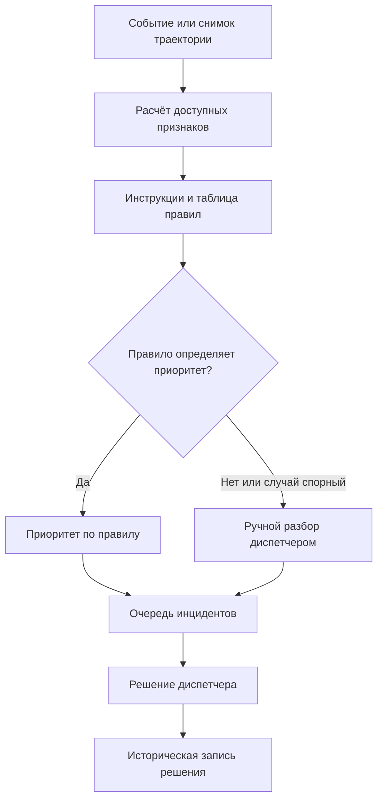
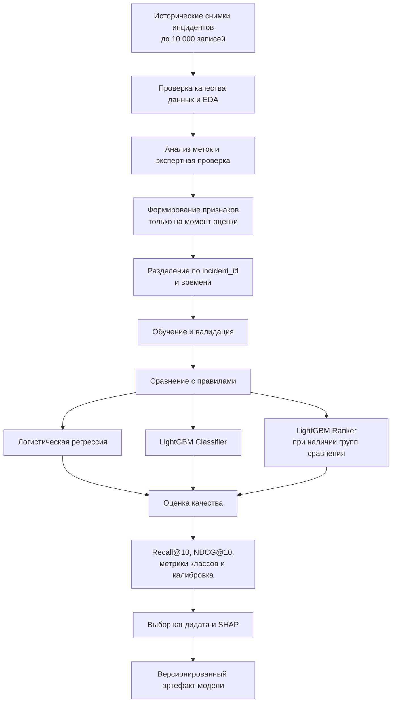
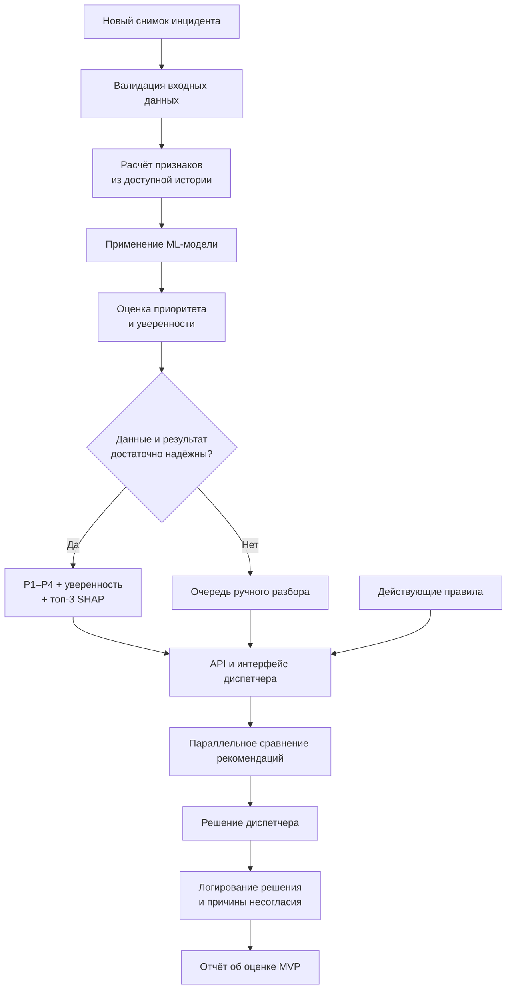

# ML System Design Doc -- [RU]

## Дизайн ML системы -- Industrial Event Ranker (Умный помощник диспетчера), MVP, итерация 1

**Версия:** 0.1

# 1. Цели и предпосылки

## 1.1. Зачем идём в разработку продукта?

### Бизнес-цель -- Product Owner

Разработать интеллектуальный помощник диспетчера крупного логистического терминала, который автоматически приоритизирует активные инциденты на основе пространственных, временных и поведенческих характеристик объектов.

На площадке одновременно перемещаются ричтраки, погрузчики, тягачи и пеший персонал. Диспетчер получает порядка 200–400 событий за смену, из которых ориентировочно 10–20 требуют немедленной реакции.

Текущий процесс предполагает ручной разбор событий на основе инструкций, таблиц правил и экспертного опыта диспетчера. Это приводит к увеличению времени обработки очереди, неоднородности решений разных специалистов и риску того, что критический инцидент будет обработан позже менее значимого события.

**Цель продукта** -- повысить качество приоритизации и помочь диспетчеру своевременно выявлять наиболее критические инциденты, в том числе в ситуациях, которые не покрываются заранее заданными правилами.

### Почему ML может быть лучше текущего решения -- Product Owner & Data Scientist

Существующая система использует детерминированные правила вида «объект находится в зоне X, а расстояние до оборудования меньше Y -- присвоить высокий приоритет».

Такой подход эффективен для известных сценариев, однако имеет ограничения:

- не учитывает все комбинации признаков и нестандартные траектории движения;
- может недостаточно точно различать события одинакового формального типа, но с разным уровнем опасности;
- зависит от полноты правил и их своевременного обновления;
- не гарантирует согласованности решений разных диспетчеров.

ML-модель должна научиться оценивать приоритет по совокупности характеристик инцидента: расположению объекта, типу зоны, близости людей и оборудования, скорости и направлению движения, отклонениям от типичного поведения и истории наблюдений.

Модель не заменяет инструкции и не принимает решения о реагировании самостоятельно. Она формирует рекомендации, объясняет их и помогает диспетчеру эффективнее распределять внимание.

### Что считаем успехом итерации с точки зрения бизнеса -- Product Owner

Успешная итерация должна подтвердить техническую и продуктовую целесообразность применения ML для приоритизации инцидентов.

Критерии успеха:

1. На отложенных данных качество ранжирования лучше или как минимум не хуже действующей системы правил по согласованным основным метрикам. Предпочтительная цель -- улучшение NDCG\@10 при отсутствии ухудшения Recall\@10 для критических инцидентов.
2. Модель корректно выделяет события с приоритетом P1 и располагает наиболее важные события в верхней части очереди.
3. Для каждого рекомендованного приоритета предоставляются оценка уверенности и объяснение на основе признаков.
4. При недостаточных данных или низкой надёжности модель передаёт событие на ручной разбор вместо выдачи необоснованной рекомендации.
5. Время от поступления новых данных до обновления приоритета и очереди не превышает 5 секунд в рамках тестового стенда.
6. Прототип позволяет сравнивать рекомендации модели с текущими правилами и сохранять решения диспетчера, включая причины несогласия.

Целевые абсолютные значения качества и минимальный необходимый прирост относительно бейзлайна будут зафиксированы после первичного измерения бейзлайна и анализа данных, но до итоговой оценки на тестовой выборке.

Разработка не предполагает автоматического управления техникой или автоматического выполнения действий по устранению инцидентов.

## 1.2. Бизнес-требования и ограничения

### Краткое описание бизнес-требований -- Product Owner

**Industrial Event Ranker** -- интеллектуальная система ранжирования активных инцидентов на логистическом терминале.

В систему поступает информация о движущихся объектах и связанных с ними событиях. Для каждого инцидента формируется снимок состояния на момент оценки. На основании доступных признаков модель рассчитывает приоритет, после чего активные инциденты упорядочиваются для диспетчера.

Система должна поддерживать следующие сценарии:

- появление движущегося объекта в запретной или опасной зоне;
- приближение техники к человеку или ценному оборудованию;
- необычная траектория, резкое изменение направления или остановка в неположенном месте;
- нарушение границы разрешённой зоны;
- движение транспорта в пешеходной зоне;
- отклонение поведения объекта от типичного для соответствующей зоны.

Для каждого инцидента система должна предоставлять:

- приоритет P1 -- критический, P2 -- высокий, P3 -- средний, P4 -- низкий;
- отдельную оценку уверенности модели;
- топ-3 признаков, наиболее повлиявших на результат;
- краткое текстовое объяснение рекомендации;
- статус ручной проверки, если качество входных данных или уверенность модели недостаточны.

Внешний документ бизнес-требований не предоставлен. Данный раздел фиксирует требования, согласованные в рамках проектирования MVP.

### Бизнес-ограничения -- Product Owner

| Ограничение                 | Требование                                                                             |
| --------------------------- | -------------------------------------------------------------------------------------- |
| Источник данных             | Имеющиеся исторические данные                                                          |
| Объём                       | До 10 000 снимков состояния инцидентов                                                 |
| Разметка                    | Метки доступны приблизительно для 50% снимков                                          |
| Идентификация               | Для снимков имеется `incident_id`                                                      |
| Обновление приоритета       | Не более 5 секунд от поступления новых данных до обновления очереди на тестовом стенде |
| Интерпретируемость          | Топ-3 признака и текстовое пояснение обязательны                                       |
| Принятие решений            | Окончательное решение принимает диспетчер                                              |
| Безопасное поведение        | Неуверенные и некорректные случаи направляются на ручную проверку                      |
| Производственная интеграция | Не входит в MVP                                                                        |
| Автоматическое реагирование | Не входит в MVP                                                                        |

### Что ожидаем от конкретной итерации -- Product Owner

В рамках первой итерации необходимо:

1. Провести EDA и оценить пригодность исторических данных для обучения.
2. Проверить полноту признаков, качество меток, распределение приоритетов и особенности повторных снимков одного инцидента.
3. Сформировать воспроизводимый процесс подготовки обучающей выборки.
4. Реализовать бейзлайн на основе действующих правил.
5. Сравнить несколько ML-подходов для оценки приоритета.
6. Определить применимость отдельного learning-to-rank решения.
7. Подготовить API и простой интерфейс диспетчера.
8. Реализовать объяснения прогнозов, оценку уверенности и сценарии fallback.
9. Подготовить отчёт о качестве моделей, сравнении с бейзлайном и ограничениях решения.

### Описание бизнес-процесса пилота

Полноценный производственный пилот не входит в объём работы. Вместо него будет реализован тестовый стенд с возможностью воспроизводить исторические события и просматривать рекомендации модели параллельно результатам действующих правил.

Предполагаемый процесс:

1. В тестовый контур загружается снимок состояния инцидента.
2. Система рассчитывает признаки, доступные на момент оценки.
3. Действующие правила и ML-модель формируют собственные рекомендации.
4. Интерфейс показывает диспетчеру ранжированный список, приоритеты, уверенность и объяснения.
5. Диспетчер может принять рекомендацию или изменить приоритет.
6. Решение диспетчера, итоговый приоритет и причина несогласия сохраняются для последующего анализа.

Стенд используется для сравнительной оценки на исторических данных и контролируемой демонстрации работы системы. Подключение к производственной инфраструктуре и изменение реального процесса управления терминалом не выполняются.

### Что считаем успешным пилотом и возможные пути развития -- Product Owner

Для MVP успех подтверждается следующими результатами:

- на отложенных данных проведено сравнение модели с существующими правилами;
- рассчитаны Recall\@10 для критических событий и NDCG\@10 для ранжирования;
- проверено отсутствие существенного ухудшения выявления критических инцидентов относительно бейзлайна;
- обеспечено обновление очереди в пределах установленного временного ограничения;
- реализована выдача приоритета, оценки уверенности и объяснения либо перевод события на ручную проверку;
- подготовлен работающий сервис с API и интерфейсом;
- результаты экспериментов воспроизводимы и документированы.

Конкретный минимальный прирост метрик утверждается по итогам EDA и оценки бейзлайна до начала работы с тестовой выборкой.

Возможные следующие этапы развития:

- увеличение объёма и качества экспертной разметки;
- улучшение качества моделей для редких критических классов;
- сбор обратной связи диспетчеров;
- мониторинг изменения распределения признаков и качества рекомендаций;
- организация регулярного переобучения после накопления достаточного объёма новых подтверждённых данных.

## 1.3. Что входит в скоуп проекта/итерации, что не входит

### На закрытие каких бизнес-требований подписываемся -- Data Scientist

В рамках MVP будут выполнены следующие работы.

**Работа с данными:**

- аудит исторического датасета объёмом до 10 000 снимков;
- анализ полноты, типов и распределения признаков;
- исследование распределения инцидентов по зонам, типам событий и уровням приоритета;
- выявление дисбаланса классов, пропусков, дубликатов и потенциальных ошибок разметки;
- проверка возможности восстановления групп одновременно активных инцидентов.

**Подготовка разметки:**

- анализ существующих исторических приоритетов;
- использование экспертно подтверждённого приоритета в качестве основной целевой метки;
- планирование стратифицированной экспертной переразметки части данных;
- проверка критических меток по доступным фактическим последствиям;
- использование экспертных попарных сравнений для ранжирования, если удастся сформировать подходящие группы.

**Разработка моделей:**

- реализация бейзлайна на основе существующих правил;
- обучение логистической регрессии как простого ML-бейзлайна;
- обучение LightGBM для классификации приоритета;
- эксперимент с learning-to-rank при достаточном количестве корректно сформированных обучающих групп;
- сравнение моделей на единых выборках и по единым критериям.

**Создание прототипа:**

- API на FastAPI;
- простой интерфейс диспетчера;
- расчёт признаков и применение модели;
- вывод приоритета и оценки уверенности;
- SHAP-объяснения для поддерживаемых моделей;
- проверка входных данных и fallback;
- логирование рекомендаций, решений диспетчера и причин несогласия;
- контейнеризация с помощью Docker.

### Что не будет закрыто -- Data Scientist

В рамках текущей итерации не предусматриваются:

- сбор новых данных с датчиков и изменение существующей системы сбора;
- интеграция с реальной производственной инфраструктурой;
- полноценный эксплуатационный пилот;
- автоматическое выполнение действий по реагированию на инциденты;
- автоматическая генерация рекомендаций по устранению инцидентов;
- полноценная промышленная инфраструктура мониторинга и переобучения;
- гарантированная работа при промышленной нагрузке, отказоустойчивость и масштабирование;
- доказательство снижения фактического ущерба или времени реакции на реальной площадке.

Эти ограничения необходимо учитывать при интерпретации результатов: высокая офлайн-метрика подтвердит перспективность подхода, но сама по себе не доказывает снижение производственных рисков.

### Качество кода и воспроизводимость -- Data Scientist

Результат должен представлять собой воспроизводимый программный прототип со следующими характеристиками:

- раздельные модули подготовки данных, генерации признаков, обучения, оценки и инференса;
- единая схема входных данных и результатов модели;
- фиксированные версии библиотек и зависимостей;
- конфигурация экспериментов и фиксируемые случайные состояния там, где они применимы;
- сохранение параметров обучения, версий моделей и результатов экспериментов;
- воспроизводимая процедура формирования обучающей и тестовой выборок;
- автоматизированные проверки схемы данных и обязательных признаков;
- Docker-конфигурация для запуска приложения;
- документированная инструкция запуска и воспроизведения экспериментов.

### Планируемый технический долг -- Data Scientist

Для ускорения разработки MVP допускаются следующие ограничения:

- хранение конфигураций и артефактов локально либо в простом файловом хранилище;
- упрощённый мониторинг качества и производительности;
- ручное управление версиями моделей;
- отсутствие автоматического переобучения;
- ограниченная поддержка новых категорий и неизвестных типов событий;
- упрощённая логика обнаружения объектов, не похожих на обучающие примеры;
- отсутствие промышленной отказоустойчивости и масштабирования;
- ограниченная автоматизация сбора и экспертной проверки новых меток.

## 1.4. Предпосылки решения

### Объект и гранулярность модели -- Data Scientist

Основная единица анализа -- **снимок состояния инцидента на конкретный момент времени**.

Один инцидент может представляться несколькими снимками по мере поступления новых наблюдений. Система пересчитывает его приоритет при изменении значимых признаков.

Каждый снимок должен содержать `incident_id`, временную метку оценки и набор признаков, доступных на соответствующий момент.

Модель не прогнозирует окончательные последствия инцидента и не использует финальные сведения о нём как входные признаки. Её задача -- определить приоритет на основании текущего состояния и доступной истории.

### Источники данных

Предполагается использование исторического датасета объёмом до 10 000 снимков. Около 50% записей имеют метки приоритета.

Окончательные решения по структуре данных принимаются по результатам EDA.

### Основные группы признаков

| Группа             | Примеры признаков                                                       | Правила использования                                         |
| ------------------ | ----------------------------------------------------------------------- | ------------------------------------------------------------- |
| Местоположение     | Координаты, идентификатор площадки, расстояние до границ зон и объектов | Значения, доступные на момент оценки                          |
| Зоны               | Тип зоны, уровень опасности, режим доступа                              | Актуальные характеристики зоны                                |
| Ближайшие объекты  | Тип, расстояние, значимость и состояние объекта                         | Только сведения, известные на момент оценки                   |
| Движение           | Скорость, направление, ускорение, изменение траектории                  | Расчёт по текущим и прошлым наблюдениям                       |
| Временной контекст | Время суток, день недели, длительность инцидента, число наблюдений      | Длительность рассчитывается только на момент оценки           |
| Контекст события   | Тип события, источник, число предыдущих инцидентов с объектом           | Только историческая информация                                |
| Целевая метка      | P1–P4, экспертная оценка, доступные последствия                         | Используется для обучения и оценки, но не как входной признак |

### Целевая переменная и доверие к меткам

Основная целевая переменная -- экспертно подтверждённый приоритет инцидента.

Для формирования обучающих данных предусматриваются три источника информации:

1. **Исторические приоритеты диспетчера.** Используются как вспомогательный источник после анализа качества и согласованности.
2. **Экспертно подтверждённые приоритеты.** Основной источник целевых меток, включая стратифицированную переразметку части выборки.
3. **Фактические последствия.** Используются для дополнительной проверки меток критических событий, если соответствующие сведения доступны.

Экспертные попарные сравнения «какой инцидент важнее» могут применяться для обучения и проверки ранжировщика.

Исторические и экспертные метки должны храниться с указанием источника. При недостаточном объёме экспертной разметки влияние исторических меток оценивается отдельно; их нельзя автоматически считать равнозначными экспертно подтверждённым приоритетам.

### Предположения о временной структуре

1. Для одного `incident_id` могут существовать несколько снимков состояния.
2. Все признаки рассчитываются только по наблюдениям, время которых не позже момента оценки.
3. Признаки, требующие знания будущего события, не используются.
4. Все снимки одного инцидента должны попадать только в одну выборку при разделении данных на train, validation и test.
5. Предпочтительно использовать временное разделение по моменту начала инцидента, чтобы оценка лучше отражала будущую эксплуатацию.

Если данные не позволяют восстановить временную последовательность и набор одновременно активных инцидентов, возможности оценки ранжирования должны быть отдельно ограничены и задокументированы.

### Требования к приоритету, уверенности и объяснению

Выход модели включает три независимых компонента:

- **Приоритет:** P1 -- критический, P2 -- высокий, P3 -- средний, P4 -- низкий.
- **Уверенность:** вероятность предсказанного класса для классификационной модели.
- **Объяснение:** три наиболее значимых признака с краткой текстовой интерпретацией.

Численная оценка ранжировщика не должна автоматически интерпретироваться как вероятность. Если отдельный ranking-подход окажется лучшим по метрикам, способ оценки его надёжности необходимо проверить отдельно.

### Предположения по безопасности

Если отсутствуют обязательные признаки, встречаются неизвестные или некорректные значения либо надёжность оценки ниже установленного порога, инцидент направляется в отдельную очередь «Требует ручного разбора».

Порог уверенности и правила обработки неизвестных данных определяются на валидационной выборке. При этом безопасность не должна зависеть исключительно от уверенности модели: обязательные проверки качества входных данных выполняются независимо.

# 2. Методология

## 2.1. Постановка задачи -- Data Scientist

### Основная ML-задача

Задача формулируется как **supervised классификация приоритета инцидента с последующим ранжированием активной очереди**.

На вход подаётся снимок состояния инцидента, содержащий пространственные, временные и поведенческие признаки, доступные на момент оценки.

Модель предсказывает один из четырёх классов P1–P4. Результаты используются для формирования ранжированного списка активных инцидентов. Внутри одного уровня приоритета порядок может определяться оценкой модели с учётом её предсказанных вероятностей.

Отдельно исследуется learning-to-rank подход, оптимизирующий порядок событий непосредственно.

### Сравниваемые подходы

**1. Бейзлайн -- существующие правила**

Применяются текущие инструкции и таблицы правил. Для спорных случаев используется предусмотренный процесс ручного разбора.

Это основной ориентир для сравнения качества.

**2. Простой ML-бейзлайн -- логистическая регрессия**

Многоклассовая логистическая регрессия позволяет проверить, достаточно ли линейных зависимостей между признаками и приоритетами. Она используется как простая модель, обеспечивающая понятный контрольный результат.

**3. Основной кандидат -- LightGBM**

LightGBM для классификации рассматривается как основной кандидат для табличных признаков, поскольку позволяет учитывать нелинейные зависимости и взаимодействия между местоположением, типом зоны и характеристиками движения.

Для объяснений применяются SHAP. Качество классификации, калибровка вероятностей и качество итогового ранжирования проверяются отдельно.

**Дополнительный эксперимент -- learning-to-rank.**

Если структура исторических данных позволяет восстановить группы одновременно активных инцидентов, а экспертные попарные сравнения дают достаточную обучающую выборку, исследуется LightGBM Ranker или другой подход к ранжированию.

Для такого обучения необходимо определить группы сравнения: например, набор инцидентов, находившихся в очереди в конкретный момент времени. Без корректных групп нельзя обоснованно обучать и оценивать модель ранжирования непосредственно.

С учётом размера датасета и частичной разметки learning-to-rank является дополнительным экспериментом, а не обязательным условием готовности MVP.

### Подготовка данных и разделение выборок

План подготовки данных:

1. Проверить схему, пропуски, дубликаты, типы значений и корректность временных меток.
2. Проанализировать долю размеченных событий и распределение приоритетов.
3. Оценить согласованность исторических и экспертных меток.
4. Проверить повторные снимки одного инцидента и возможные пересечения между выборками.
5. Подготовить признаки, используя только информацию, доступную на момент оценки.
6. Сформировать обучающую, валидационную и тестовую выборки с учётом идентификатора инцидента и времени.
7. Обучить модели, настроить параметры и пороги только на тренировочной и валидационной частях.
8. Провести итоговое сравнение на ранее не использованной тестовой выборке.

Предварительно рассматривается разбиение примерно 70/15/15 по уникальным инцидентам с временным принципом разделения. Пропорции могут быть скорректированы по итогам EDA, если в отдельных приоритетах недостаточно примеров.

Записи одного `incident_id` не должны попадать одновременно в обучение и тестирование. Это предотвращает завышение качества из-за сходства нескольких снимков одного и того же инцидента.

Неразмеченные данные могут использоваться для EDA, оценки качества признаков и анализа покрытия. Они не включаются в обучение как примеры с известным приоритетом без отдельного обоснования метода работы с частичной разметкой.

### Метрики качества

**Основные метрики ранжирования:**

- **Recall\@10 для P1:** доля критических инцидентов, попавших в первые десять позиций очереди.
- **NDCG\@10:** качество порядка событий в первых десяти позициях с учётом относительной важности приоритетов.

Для их расчёта нужно восстановить группы активных инцидентов на моменты оценки либо определить другой обоснованный способ формирования групп. Если восстановление очередей по историческим данным невозможно, ограничение фиксируется в результатах эксперимента.

**Дополнительные метрики:**

- macro F1 и метрики по каждому классу;
- полнота критического класса P1;
- точность первых десяти позиций;
- матрица ошибок;
- доля событий, направленных на ручную проверку;
- задержка обработки и обновления очереди.

Основной акцент делается на полноте обнаружения критических инцидентов и качестве верхней части очереди. Среднее качество классификации по всем событиям недостаточно для оценки безопасности продукта: модель может показывать хорошее общее качество и при этом пропускать редкие критические события.

### Работа с уверенностью и объяснимостью

Для классификационной модели вероятности классов калибруются на валидационной выборке при достаточном количестве размеченных примеров.

Топ-3 признака формируется с помощью SHAP. Объяснение показывает вклад признаков в предсказание модели, но не должно интерпретироваться как доказательство причинно-следственной связи.

Для каждого ответа API предусматриваются:

- предсказанный приоритет;
- оценка уверенности;
- топ-3 признака и краткое объяснение;
- статус проверки входных данных;
- статус ручной проверки, если результат не может быть надёжно использован.

Для модели, не прошедшей порог уверенности или проверку входных данных, система возвращает статус ручного разбора вместо обычной рекомендации.

### План технической реализации

**Основной стек:**

- Python;
- pandas и scikit-learn;
- LightGBM;
- SHAP;
- FastAPI;
- Docker;
- простой веб-интерфейс.

Планируемые компоненты:

1. Модуль загрузки и валидации данных.
2. Модуль расчёта признаков.
3. Пайплайн обучения и оценки.
4. Модуль применения модели и калибровки уверенности.
5. Модуль объяснений.
6. API для получения рекомендаций и обновления очереди.
7. Интерфейс просмотра активных инцидентов.
8. Логирование решений и результатов проверки.

## 2.2. Блок-схема решения -- Data Scientist

### Бейзлайн: действующий процесс

Бейзлайн должен отражать текущую логику приоритизации и использоваться как контрольная система при оценке MVP.

Существующий процесс обеспечивает обработку типовых событий, но зависит от полноты правил и индивидуального опыта специалистов. Этот процесс является основным бейзлайном для сравнения.

### MVP: подготовка данных и обучение

Данный пайплайн включает анализ качества исторической разметки. Экспертно подтверждённые метки используются как основной источник целевой переменной, а исторические метки и фактические последствия -- как вспомогательная информация в соответствии с их доступностью и надёжностью.

### MVP: применение модели и формирование очереди

Архитектура обеспечивает параллельный показ результатов правил и ML-модели. Диспетчер сохраняет право окончательного решения.

Обновление приоритета должно укладываться в пять секунд на тестовом стенде. При измерении необходимо отдельно фиксировать задержку обработки и задержку полного обновления интерфейса.

Fallback переводит событие в отдельную очередь «Требует ручного разбора». Такая очередь должна быть заметной для диспетчера, а не смешиваться с подтверждёнными событиями P1.
